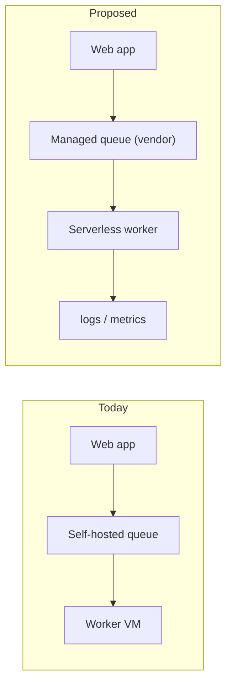
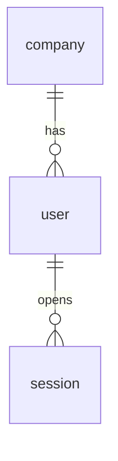

# RFC template

The house template for every RFC. Keep the section numbers as they are, so
reviewers find their way around the same way in every RFC.

Copy the skeleton, then use the notes under each heading to fill it. Delete the
notes. Scale to the decision: a vendor choice may be two pages; a platform
migration may be twenty.

---

```markdown
# RFC: <decision in a few words>   <- becomes the Linear title `RFC-NNN: ...`; not part of the content

| Field         | Value                                      |
| ------------- | ------------------------------------------ |
| **Author**    | <name (role)>                              |
| **Status**    | Draft                                      |
| **Date**      | <YYYY-MM-DD>                               |
| **Decider**   | <who signs off>                            |
| **Reviewers** | <who should comment>                       |
| **Comment by**| <date>                                     |
| **Linear**    | <issue or project link>                    |
| **Decision issue** | <TEAM-123 link, added when In Review>  |
| **Supersedes** | <ADR or RFC it replaces, optional>        |
| **Related**   | <PRs, docs, earlier RFCs, optional>        |

## TL;DR

<3-5 lines: what is proposed, the main reason, and what you need from readers.>

## 1. Context & Background

- **The problem:** ...
- **Current condition:** ...
- **Impact:** ...

## 2. Goals & Non-Goals

### In scope
### Out of scope

## 3. Proposed Solution

### Design
### Data / API / infra changes
### Cost

## 4. Alternatives Considered

## 5. Cross-Functional Impact

## 6. Task Breakdown

## 7. Rollout Strategy

## 8. Open Questions

## 9. Signoff
```

---

## Notes per section

**Header table.** Status starts at `Draft`. `Decision issue` stays out (or `—`)
while Draft; publish step 3 adds it. Drop `Supersedes` and `Related` when empty.
`Decider` and `Comment by` turn an
open-ended discussion into one that ends; leave them as `TBD` only if the user
truly doesn't know, and list that as an open question.

**TL;DR.** A reviewer skimming Linear should get the decision without
scrolling. Write it last.

**Amendments** (only after review). Insert `## 0. Amendment A (<date>) -- supersedes
conflicting text below` above section 1: numbered changes, each naming the
section it overrides, then task deltas. Later amendments are B, C, ... above A.

**1. Context & Background**
- *The problem:* what is wrong or missing, in terms of consequences, not solutions.
- *Current condition:* how things work today, with file paths, systems, and
  measured numbers ("measured live on <date>: ..."). This is where credibility
  is won.
- *Impact:* what changes for the business, users, or team if this lands.

**2. Goals & Non-Goals.** Concrete, checkable goals. Non-goals name the tempting
adjacent work you are deliberately not doing and why; mark deferred items with
the phase they move to.

**3. Proposed Solution.** Enough detail that a reviewer can find a flaw. For
infrastructure: components, data flow, where it runs, how it's managed (prefer
infrastructure as code here), observability. Include data model or API changes as tables or
code. Put a cost estimate with its assumptions and the date prices were checked.
Add the diagrams the change calls for (see "Diagrams" in SKILL.md), usually as
`### Architecture`, `### Data flow`, `### Data model (ERD)` subsections, each
with a current vs proposed view when the change is the point.

Architecture example (Mermaid renders in Linear):



ERD example (Mermaid for relations, a table per table for columns):



| column | type | null | key | notes |
| --- | --- | --- | --- | --- |
| id | uuid | no | PK | |
| company_id | uuid | no | FK company.id | |

**4. Alternatives Considered.** A table works well for comparisons:

| Option | Strengths | Weaknesses | Cost | Why not chosen |
| --- | --- | --- | --- | --- |

Always include "do nothing / keep current" as an option, with its real cost.
Each rejected option gets its best case and the specific reason it lost.

**5. Cross-Functional Impact.** Who else is affected and how: data team,
operations or support staff, sales/clients, other services, security and licensing, data
residency, on-call. One short paragraph or bullet each.

**6. Task Breakdown.** Tasks with rough size, ordered, linked to Linear issues
when they exist (or note "to be created on acceptance").

**7. Rollout Strategy.** The order of steps, what runs during each gap (hand-
applied migrations, config syncs, service deploys, infrastructure applies), feature
flags or trial periods, success criteria, and the rollback for each step.

**8. Open Questions.** Numbered. Each: the question, why it matters, who should
answer, and by when. Resolved ones stay, struck through or marked
`Resolved (<date>): <answer>`, so the reasoning trail survives.

**9. Signoff.**

| Role | Name | Decision | Date |
| --- | --- | --- | --- |
| Decider | | | |
| Reviewer | | | |
